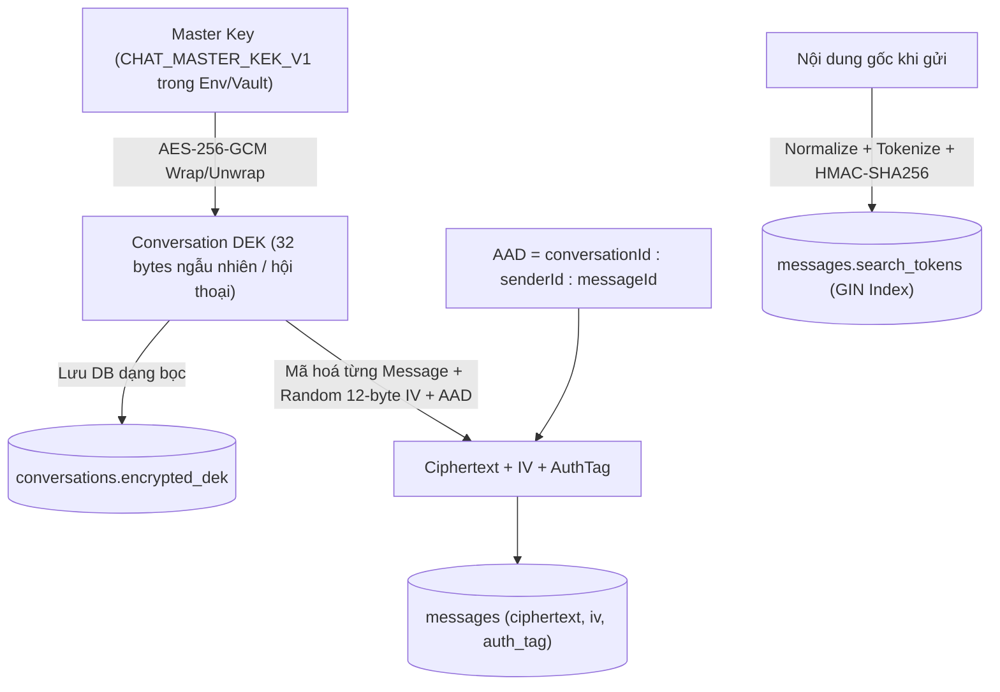

# Lộ trình Nâng cấp Chat Hub Trung tâm (Picare Core Server)

> Tài liệu đặc tả kiến trúc và lộ trình nâng cấp `ChatService` tại `Picare_Core_Server` thành **Centralized Enterprise Chat Hub** cho toàn hệ sinh thái (**Office, OMS, WMS, SFA**), trong đó **Picare Office** là hệ thống đầu tiên tích hợp giao diện Chat chính (Full UI), còn **OMS, WMS, SFA** tích hợp dạng Dropdown/Drawer Widget và luân chuyển dữ liệu nghiệp vụ qua gRPC.

---

## 1. Hiện trạng & Các vấn đề cần giải quyết tại Core

Hiện tại `Picare_Core_Server` đã có nền tảng cơ bản tại:
- Models: [`src/models/chat/conversation.model.js`](../src/models/chat/conversation.model.js), [`conversation_member.model.js`](../src/models/chat/conversation_member.model.js), [`message.model.js`](../src/models/chat/message.model.js), [`message_attachment.model.js`](../src/models/chat/message_attachment.model.js).
- Services: [`src/services/chat.service.js`](../src/services/chat.service.js), [`src/services/socket.service.js`](../src/services/socket.service.js), [`src/services/sse_publisher.service.js`](../src/services/sse_publisher.service.js).

### Điểm nghẽn hiện tại cần khắc phục:
1. **Bảo mật & Mã hoá:** Nội dung tin nhắn (`messages.content`) đang lưu dạng plain-text trong PostgreSQL. Chưa có cơ chế mã hoá chống rò rỉ dữ liệu nhạy cảm nội bộ (báo giá, đơn hàng, phê duyệt chi phí) khi lộ DB hoặc file backup.
2. **Hiệu năng truy vấn & Real-time:**
   - `getMyConversations` chưa tính số tin chưa đọc (`unreadCount`), hoặc nếu tính bằng `COUNT(*)` sẽ gây nghẽn N+1 khi danh sách hội thoại lớn.
   - `sendMessage` thực hiện 6 bước truy vấn DB tuần tự và lặp `for` gọi Redis `publish` từng thành viên thay vì dùng pipeline.
   - Phân trang tin nhắn theo `createdAt` đơn thuần dễ sót bản ghi trùng mili-giây và chưa tối ưu index cho hội thoại hàng trăm nghìn tin nhắn.
   - `socket.on("join_conversation")` trong `SocketService` chưa kiểm tra quyền thành viên (`ConversationMember`) trước khi cho phép join room.
3. **Tính năng Chat nâng cao:**
   - Mới có ghim hội thoại (`ConversationMember.isPinned`), chưa có **ghim tin nhắn trong hội thoại** (`PinnedMessage`).
   - Gửi file/ảnh mới chỉ lưu mảng URL truyền từ client, chưa gắn kết chặt với luồng `S3Service` (`s3_assets`, presigned URL, thumbnail/blurhash, kiểm soát quyền truy cập file private).
   - Chưa hỗ trợ loại tin nhắn **Entity Card** (Đơn hàng SFA/OMS, Phiếu kho WMS, Đơn duyệt chi Office) để click và redirect liên hệ thống.
4. **Kết nối liên Repo (Cross-Repo):**
   - Trong [`proto/auth.proto`](../proto/auth.proto) chưa có `ChatGrpcService` để `Picare-Office-Server`, `OMS`, `WMS`, `SFA` gọi sang tạo hội thoại theo phòng ban/đơn hàng, gửi thẻ nghiệp vụ hoặc đồng bộ trạng thái.
   - Kênh Redis Event Bus giữa Core (`user:{userId}`) và Office (`sse:notifications` / `sse:chat`) chưa đồng nhất định dạng envelope.

---

## 2. Thiết kế Dữ liệu & Mở rộng Schema tại Core

Tuân thủ tiêu chuẩn migration idempotent và `protectedTables` của `Picare_Core_Server`.

### 2.1. Bảng mở rộng và bảng mới

| Bảng | Thay đổi / Cột chính | Mục đích & Ràng buộc |
|---|---|---|
| `conversations` | Thêm `scope_system` (`CORE`, `OFFICE`, `OMS`, `WMS`, `SFA`), `company_id` (nullable), `context_type`, `context_id`, `encrypted_dek` (TEXT), `dek_version` (INT), `pinned_count` (INT default 0) | Liên kết cuộc hội thoại với ngữ cảnh nghiệp vụ (VD: nhóm phòng ban Office, nhóm xử lý đơn hàng) và lưu Data Encryption Key đã bọc (wrapped DEK). |
| `conversation_members` | Thêm `unread_count` (INT default 0), `last_read_message_id` (UUID nullable), `mention_count` (INT default 0) | Đọc tức thì số tin chưa đọc và số lần được `@mention` mà không cần `COUNT(*)` trên bảng `messages`. |
| `messages` | Mở rộng `type` (`text`, `image`, `file`, `system`, `entity_card`, `mixed`); thêm `ciphertext` (TEXT), `iv` (VARCHAR 32), `auth_tag` (VARCHAR 32), `key_version` (INT), `search_tokens` (TEXT[]), `metadata` (JSONB), `encrypted_metadata` (TEXT), `client_message_id` (VARCHAR 64) | Lưu nội dung đã mã hoá AES-256-GCM, token tìm kiếm mù (Blind Index), payload thẻ nghiệp vụ (`entity_card`) và chống gửi trùng (`UNIQUE(conversation_id, sender_id, client_message_id)`). |
| `message_attachments` | Thêm `s3_asset_id` (UUID nullable), `s3_key` (TEXT), `width` (INT), `height` (INT), `blurhash` (VARCHAR 100), `duration_ms` (INT), `is_encrypted` (BOOLEAN default false) | Quản lý file private thông qua `s3_assets` của Core; không lưu URL public cố định cho file nội bộ nhạy cảm. |
| `pinned_messages` *(Mới)* | `id` (UUID PK), `conversation_id`, `message_id`, `pinned_by` (`user_id`), `note` (VARCHAR 255), `pin_order` (INT), `created_at` | Ghim nhiều tin nhắn quan trọng (thông báo, đơn hàng, chứng từ) lên đầu khung chat. Unique `(conversation_id, message_id)`. |
| `message_reactions` *(Mới - Tuỳ chọn GĐ 2)* | `id` (UUID PK), `message_id`, `conversation_id`, `user_id`, `emoji` (VARCHAR 32), `created_at` | Thả biểu cảm nhanh trên tin nhắn/đơn hàng (👍, ✅, 👀). Unique `(message_id, user_id, emoji)`. |

### 2.2. Chiến lược Index tối ưu tốc độ
- `messages`:
  - `idx_messages_conv_cursor`: `(conversation_id, created_at DESC, id DESC) WHERE deleted_at IS NULL` — phục vụ cursor pagination dưới 5ms.
  - `idx_messages_search_tokens`: `USING GIN (search_tokens)` — tìm kiếm từ khoá trên tin nhắn đã mã hoá.
  - `uq_messages_idempotency`: `UNIQUE (conversation_id, sender_id, client_message_id)` — chống double-submit khi mạng chập chờn.
- `pinned_messages`:
  - `idx_pinned_messages_conv`: `(conversation_id, pin_order ASC, created_at DESC)`.

---

## 3. Kiến trúc Mã hoá Tin nhắn Nội bộ (Defense-in-Depth Encryption)

Áp dụng mô hình **Envelope Encryption (AES-256-GCM) theo từng Conversation** kết hợp **HMAC Blind Index**:



1. **Sinh và Quản lý Khoá (`ChatCryptoService`):**
   - Mỗi `Conversation` khi tạo mới sinh 1 khoá `DEK` 32 bytes bằng `crypto.randomBytes(32)`.
   - `DEK` được mã hoá bằng `CHAT_MASTER_KEK` (Key Encryption Key) lưu vào `conversations.encrypted_dek` kèm `dek_version`.
   - Cache `DEK` đã giải mã trong bộ nhớ LRU ngắn hạn (TTL 5–10 phút) tại process Core để không phải giải mã lại DEK ở mỗi tin nhắn.
2. **Mã hoá Tin nhắn & Chống giả mạo (Authenticated Encryption with Associated Data - AAD):**
   - Thuật toán: `aes-256-gcm` với `iv = crypto.randomBytes(12)`.
   - `AAD` (Additional Authenticated Data) được truyền vào `cipher.setAAD(Buffer.from(`${conversationId}:${senderId}:${messageId}`))`.
   - **Đảm bảo:** Kể cả khi DB bị truy cập trái phép và kẻ tấn công copy `ciphertext` từ hội thoại này sang hội thoại khác hoặc đổi `sender_id`, bước `decipher.final()` sẽ báo lỗi xác thực `AuthTag` ngay lập tức.
3. **Tìm kiếm trên Dữ liệu Mã hoá (Blind Indexing):**
   - Tách câu tiếng Việt/tiếng Anh thành các từ chuẩn hoá (bỏ dấu/giữ dấu, chữ thường, độ dài $\ge 2$).
   - Băm mỗi từ bằng `HMAC-SHA256(token, deriveSearchKey(DEK))` lấy 16 ký tự hex đầu tiên lưu vào mảng `messages.search_tokens`.
   - Khi người dùng tìm kiếm trong cuộc hội thoại, Core băm từ khoá tìm kiếm thành token và query: `WHERE conversation_id = :cid AND search_tokens @> ARRAY[:hashedTokens]`.
4. **Xoay vòng khoá (Key Rotation):**
   - Hỗ trợ cấu hình `CHAT_MASTER_KEK_CURRENT_VERSION` và keyring nhiều version (`V1`, `V2`). Job nền có thể re-wrap `conversations.encrypted_dek` từ `V1` sang `V2` mà không cần giải mã/mã hoá lại hàng triệu dòng trong bảng `messages`.

---

## 4. Luồng Gửi Ảnh, File & Bảo mật S3

Thay vì để client tự truyền `fileUrl` bất kỳ vào `sendMessage`:

1. **Upload qua Core S3 Pipeline:**
   - **File nhỏ / Ảnh chụp màn hình ($\le 15\text{MB}$):** Upload qua endpoint Chat Attachment hoặc gRPC `S3Service.QueueUpload` với prefix riêng `chat-attachments/{conversationId}/{yyyy}/{mm}/`.
   - **File lớn ($\le 100\text{MB}$):** Core cấp **Presigned PUT URL** có thời hạn 5 phút kèm điều kiện `Content-Length` và `Content-Type` để trình duyệt đẩy thẳng lên S3, sau đó gọi xác nhận hoàn tất để tạo bản ghi `s3_assets` (`visibility = PRIVATE`).
2. **Xử lý Ảnh & Preview:**
   - Trích xuất `width`, `height`, sinh `blurhash` (hoặc `thumbnailUrl`) để khung chat phía Office và Dropdown các hệ thống không bị nhảy layout khi tải ảnh.
3. **Kiểm soát Quyền Xem/Tải File:**
   - Không trả URL S3 public vĩnh viễn.
   - Khi `getMessages` hoặc emit `new_message`, Core ký **Presigned GET URL** ngắn hạn (hoặc trả URL qua cổng `/api/v1/chat/attachments/:id/download` có kiểm tra `ConversationMember`) để đảm bảo người ngoài cuộc hội thoại không thể mở file dù có link.

---

## 5. Cấu trúc Entity Card & Liên kết Đa Hệ thống (Office, OMS, WMS, SFA)

Để gửi Đơn hàng, Sản phẩm, Phiếu kho, hoặc Đơn duyệt chi giữa các hệ thống:

### 5.1. Schema chuẩn của `messages.metadata` cho `type = "entity_card"`

```json
{
  "schemaVersion": 1,
  "entityType": "EXPENSE_REQUEST | SALES_ORDER | PURCHASE_ORDER | PRODUCT | WMS_RECEIPT | TASK",
  "sourceSystem": "OFFICE | SFA | OMS | WMS",
  "entityId": "uuid-hoac-id-nghiep-vu",
  "entityCode": "EXP-202611-0042",
  "companyId": "comp_01",
  "snapshot": {
    "title": "Đề nghị duyệt chi mua thiết bị kho Q4",
    "subtitle": "Phòng Vận hành • 45.000.000 ₫",
    "status": "PENDING",
    "statusLabel": "Chờ Trưởng phòng duyệt",
    "statusColor": "warning",
    "amount": 45000000,
    "currency": "VND",
    "attributes": [
      { "label": "Người đề nghị", "value": "Nguyễn Văn A" },
      { "label": "Hạn xử lý", "value": "2026-11-15" }
    ]
  },
  "navigation": {
    "primarySystem": "OFFICE",
    "path": "/approvals/expense-requests/uuid-hoac-id-nghiep-vu",
    "fallbackPaths": {
      "OMS": "/orders/SO-202611-0089",
      "SFA": "/sales/orders/SO-202611-0089"
    }
  }
}
```

### 5.2. Cơ chế Deep-Link Redirect
- Core cung cấp registry domain các hệ thống (`OFFICE_WEB_URL`, `OMS_WEB_URL`, `WMS_WEB_URL`, `SFA_WEB_URL`).
- Khi User B click vào `entity_card`:
  - Nếu B đang mở giao diện của chính `primarySystem` (ví dụ đang ở Office và click vào Đơn duyệt chi Office): Frontend điều hướng nội bộ (`SPA router push`).
  - Nếu B đang ở Office nhưng click vào Đơn hàng `SFA` (hoặc đang ở Dropdown `OMS` click vào Đơn duyệt chi `OFFICE`): Frontend điều hướng sang `${SYSTEM_URL}${navigation.path}?fromChat=${conversationId}&msgId=${messageId}`. Do toàn bộ hệ sinh thái dùng chung phiên đăng nhập JWT của Core nên User B vào thẳng màn hình xử lý mà không cần đăng nhập lại.

---

## 6. Hợp đồng gRPC `ChatService` & Redis Event Bus

### 6.1. Mở rộng `proto/auth.proto` (hoặc `proto/chat.proto`)

```protobuf
service ChatService {
  // Tạo hoặc lấy hội thoại 1-1 / nhóm theo ngữ cảnh nghiệp vụ (VD: từ Office hoặc SFA)
  rpc EnsureConversation (EnsureConversationRequest) returns (ConversationResponse) {}

  // Gửi tin nhắn văn bản hoặc Entity Card từ các repo (Office, OMS, WMS, SFA) sang Core
  rpc SendMessage (GrpcSendMessageRequest) returns (GrpcMessageResponse) {}

  // Cập nhật trạng thái trực tiếp trên Entity Card khi chứng từ/đơn hàng đổi trạng thái
  rpc UpdateEntityCardSnapshot (UpdateEntityCardSnapshotRequest) returns (SimpleChatResponse) {}

  // Lấy danh sách hội thoại + tổng số tin chưa đọc cho Dropdown UI hoặc Header Badge
  rpc GetUserChatSummary (UserChatSummaryRequest) returns (UserChatSummaryResponse) {}

  // Đồng bộ thành viên vào nhóm chat phòng ban/công ty khi nhân sự thay đổi bên Office
  rpc SyncConversationMembers (SyncConversationMembersRequest) returns (SimpleChatResponse) {}
}
```

### 6.2. Chuẩn hoá Real-time Transport (Socket.io + Redis Event Bus)
- **Với Office Web UI (Chat chính):** Kết nối trực tiếp WebSocket (`Socket.io`) tới `Picare_Core_Server` (hoặc qua API Gateway) để có độ trễ thấp nhất (< 20ms), hỗ trợ đầy đủ `typing`, `presence`, `message_read`, `message_pinned`, `entity_card_updated`.
- **Với Backend các Repo (Office Server, OMS, WMS, SFA):**
  - Core phát sự kiện qua Redis Event Bus sử dụng `redis.pipeline()`.
  - Chuẩn hoá kênh phát để tương thích với cả `user:{userId}` và `sse:chat` (có `targetUserIds`), giúp các hệ thống đang dùng SSE (như `Picare-Office-Server/src/config/sse.config.js`) nhận được sự kiện real-time ngay mà không cần mở thêm kết nối thừa.

---

## 7. Lộ trình Triển khai tại `Picare_Core_Server` (Các mốc C0 → C4)

| Mốc | Hạng mục tại Core | File tác động chính | Tiêu chí hoàn thành (DoD) |
|---|---|---|---|
| **C0 — Cứng hoá & Tối ưu nền hiện tại** | • Thêm `unread_count` vào `conversation_members`.<br>• Tối ưu `sendMessage` (giảm số query, dùng Redis pipeline).<br>• Bổ sung kiểm tra quyền member khi `join_conversation` trong `SocketService`.<br>• Cursor pagination theo `(createdAt, id)`. | `src/models/chat/*`<br>`src/services/chat.service.js`<br>`src/services/socket.service.js`<br>`src/services/sse_publisher.service.js` | • Load danh sách hội thoại trả về `unreadCount` chính xác trong 1 query.<br>• User không thuộc hội thoại không thể join room socket.<br>• Gửi tin nhắn nhóm 50 người chỉ mất 1 lệnh Redis pipeline. |
| **C1 — Mã hoá Tin nhắn Nội bộ (Envelope Encryption)** | • Xây dựng `ChatCryptoService` (AES-256-GCM + AAD + Blind Index).<br>• Migration thêm `encrypted_dek`, `ciphertext`, `iv`, `auth_tag`, `search_tokens`.<br>• Tự động mã hoá khi ghi và giải mã khi đọc/emit; hỗ trợ đọc tương thích ngược với tin nhắn cũ. | `src/services/chat_crypto.service.js`<br>`src/services/chat.service.js`<br>`src/config/database_migration.js` | • Trong DB cột `content` để `null`, chỉ lưu `ciphertext`, `iv`, `auth_tag`.<br>• Sửa 1 byte trong DB hoặc đổi `conversation_id` sẽ bị chặn giải mã.<br>• Tìm kiếm tin nhắn theo từ khoá hoạt động qua `search_tokens`. |
| **C2 — Ghim tin nhắn, Ảnh/File S3 & Reactions** | • Tạo model & API `PinnedMessage` (ghim/bỏ ghim/danh sách tin ghim).<br>• Tích hợp upload file/ảnh chat với `S3Service` (`s3_assets` private + presigned URL + `blurhash`).<br>• Hỗ trợ `typing`, `online_presence` qua Redis. | `src/models/chat/pinned_message.model.js`<br>`src/controllers/chat.controller.js`<br>`src/routes/chat.routes.js`<br>`src/services/s3.service.js` | • Ghim/bỏ ghim phát socket real-time và lưu system message.<br>• Ảnh/file tải lên S3 ở chế độ private, trả về presigned URL hợp lệ cho thành viên hội thoại. |
| **C3 — Entity Card & Hợp đồng gRPC Liên Hệ thống** | • Hỗ trợ `type = "entity_card"` và validate schema `metadata`.<br>• Mở rộng `proto/auth.proto` với `ChatService` và triển khai gRPC handlers tại Core.<br>• Hỗ trợ RPC `UpdateEntityCardSnapshot` để cập nhật trạng thái đơn hàng/đơn duyệt trên khung chat. | `proto/auth.proto`<br>`src/grpc/*`<br>`src/services/chat.service.js` | • Office (và sau đó là OMS/WMS/SFA) gọi được gRPC để tạo nhóm chat, gửi thẻ nghiệp vụ và cập nhật trạng thái thẻ real-time. |
| **C4 — Mở rộng Dropdown SDK cho OMS, WMS, SFA** | • Chuẩn hoá payload cho Dropdown Chat Widget.<br>• Cấp phát Deep-Link Resolver giữa `OFFICE`, `OMS`, `WMS`, `SFA`.<br>• Rate-limiting & Audit log cho các thao tác chia sẻ dữ liệu nhạy cảm qua chat. | `src/services/chat.service.js`<br>`docs/chat-hub-roadmap.md` | • Click vào thẻ Đơn hàng SFA/OMS hoặc Đơn duyệt chi Office từ bất kỳ hệ thống nào đều redirect đúng URL đích. |


## Bổ sung triển khai: Phòng private bảo mật dành cho CEO

Xem [đặc tả và giới hạn phòng bảo mật](secure-private-chat.md). Triển khai bổ sung lớp bọc DEK bằng mã phòng, bcrypt verifier, chặn đọc/gửi khi thiếu mã, sự kiện realtime không có bản rõ, và huỷ wrapped DEK do người tạo thực hiện. Đây là mật mã phía server có yêu cầu mã riêng, không phải E2EE; giới hạn khôi phục từ backup và dữ liệu người nhận đã lưu được ghi rõ trong đặc tả.
